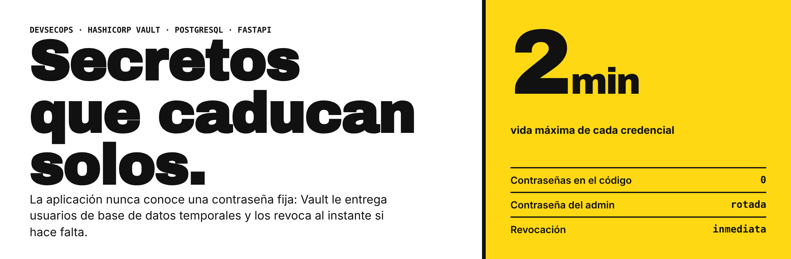
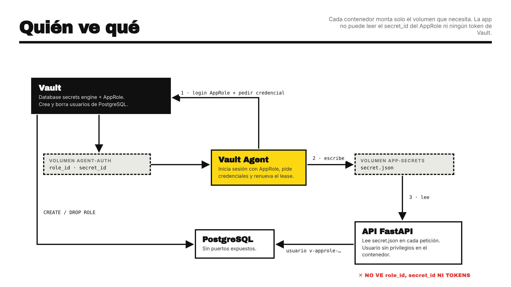
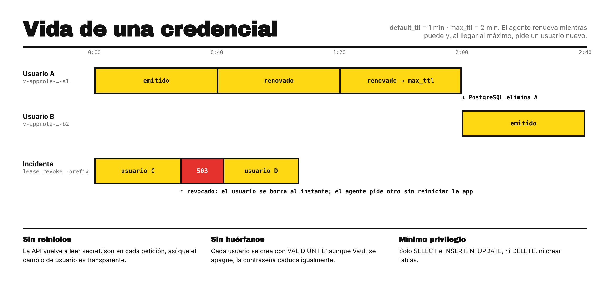
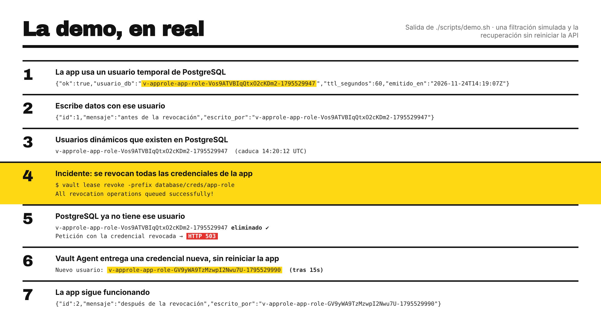

<p align="center">
  
</p>

<p align="center">
  <a href="https://github.com/hectormac35/vault-secrets-dinamicos/actions/workflows/ci.yml"></a>
  
  
  
</p>

# Vault · credenciales dinámicas de base de datos

Demo **DevSecOps** de cómo dejar de tener contraseñas fijas de base de datos. Una API en FastAPI se conecta a PostgreSQL con **usuarios temporales que crea HashiCorp Vault**. Esos usuarios caducan solos, se renuevan sin reiniciar la aplicación y se pueden revocar al instante si hay un incidente.

```bash
./levantar.sh        # PostgreSQL + Vault + Vault Agent + API, configurado en orden
./scripts/demo.sh    # simula una filtración: revoca la credencial y la app se recupera sola
```

---

## Cómo funciona

<p align="center"></p>

1. **Vault** tiene activado el *database secrets engine*. Sabe crear usuarios en PostgreSQL con permisos mínimos y una fecha de caducidad.
2. **Vault Agent** inicia sesión con **AppRole** y pide una credencial. Después la escribe en `secret.json` y renueva el *lease* mientras pueda.
3. La **API** lee `secret.json` en **cada petición**. Cuando el agente cambia el usuario, la API lo nota sin reiniciarse.

| Principio | Cómo se aplica |
|---|---|
| Sin contraseñas en el código | La API no tiene ninguna. La contraseña del administrador de PostgreSQL **la rota Vault** al arrancar, y desde ese momento nadie la conoce. |
| Mínimo privilegio | La política de Vault solo permite leer `database/creds/app-role`. El usuario de la base de datos solo tiene `SELECT` e `INSERT`. |
| Aislamiento | `role_id` y `secret_id` están en un volumen que **solo** montan Vault y el agente. La app solo ve `secret.json`. El token del agente no se escribe en disco. |
| Superficie mínima | PostgreSQL no publica puertos. Vault y la API solo escuchan en `127.0.0.1`. La API se ejecuta con un usuario sin privilegios. |
| Sin usuarios huérfanos | Cada usuario se crea con `VALID UNTIL`: aunque Vault se apague, la contraseña caduca igualmente. |
| Sin fugas en errores | Si falla la base de datos, el cliente recibe un `503` genérico y el detalle va solo al log. |

---

## Vida de una credencial

<p align="center"></p>

Con `default_ttl = 1m` y `max_ttl = 2m`, cada usuario vive como mucho dos minutos. Si se **revoca** (`vault lease revoke -prefix database/creds/app-role`), Vault lo borra de PostgreSQL en ese momento. La API devuelve `503` unos segundos y, en cuanto el agente entrega un usuario nuevo, vuelve a funcionar sin que nadie la toque. Los tiempos se pueden cambiar con `DB_TTL` y `DB_MAX_TTL` en `vault/bootstrap_vault.sh`.

### La demo de incidente, ejecutada de verdad

<p align="center"></p>

En esta ejecución, la API tardó **15 segundos** en recibir un usuario nuevo después de revocar todas sus credenciales, y lo hizo sin reiniciarse.

---

## Ponerlo en marcha

**Requisitos:** Docker con Compose v2 y `curl`.

```bash
git clone https://github.com/hectormac35/vault-secrets-dinamicos.git
cd vault-secrets-dinamicos
./levantar.sh
```

| Dirección | Qué hay |
|---|---|
| http://localhost:8081/estado | Qué usuario temporal está usando la API y cuándo se emitió (nunca la contraseña) |
| http://localhost:8081/eventos | Lista de eventos (`GET`) y alta (`POST`) |
| http://localhost:8081/docs | Documentación interactiva de la API |
| http://localhost:8200 | Interfaz web de Vault (token `root`, modo dev) |

```bash
curl -X POST http://localhost:8081/eventos \
     -H 'Content-Type: application/json' \
     -d '{"mensaje": "Hola Vault"}'
# {"id":1,"mensaje":"Hola Vault","escrito_por":"v-approle-app-role-…"}
```

`./parar.sh` lo detiene, y `./parar.sh --borrar` además elimina la base de datos.

<details>
<summary><b>Qué hace <code>levantar.sh</code> paso a paso</b></summary>

1. Arranca PostgreSQL y Vault y espera a que estén sanos.
2. Se asegura de que la tabla `eventos` existe **antes** de crear usuarios dinámicos, porque los permisos se conceden sobre las tablas que existen en ese momento.
3. Cambia la contraseña del administrador por una aleatoria de un solo uso y se la pasa a Vault, que **la rota inmediatamente**.
4. Configura el rol dinámico, la política y el AppRole, y entrega `role_id` y `secret_id` solo al agente.
5. Arranca el agente y la API, y espera a que la API reciba su primera credencial.

Se puede ejecutar varias veces: Vault en modo dev guarda todo en memoria, así que el script lo reconfigura desde cero.
</details>

---

## Tests

| Tipo | Qué comprueba | Dónde |
|---|---|---|
| Unitarios (pytest) | 503 sin secreto, nunca mostrar la contraseña, releer el secreto rotado, consultas parametrizadas, validación, no filtrar errores | `tests/` |
| Extremo a extremo | Con Vault y PostgreSQL reales: escribir con el usuario dinámico, admin rotado, la app no ve el `secret_id`, revocación y recuperación | `scripts/prueba-e2e.sh` |
| Estáticos | ShellCheck en todos los scripts y `docker compose config` | CI |

```bash
pip install -r requirements-dev.txt && pytest -q
./scripts/prueba-e2e.sh        # necesita Docker
```

La CI de GitHub Actions ejecuta los tres en cada push.

---

## Límites conocidos (es una demo)

- **Vault en modo dev:** almacenamiento en memoria, sin TLS y con un token raíz fijo. En producción iría con almacenamiento Raft, TLS, *unseal* automático y sin token raíz.
- **Entrega del `secret_id`:** aquí lo escribe el script de arranque. En producción se entregaría con *response wrapping* o con un método de autenticación de la plataforma (Kubernetes, AWS IAM, Azure MSI…).
- **Cambio de credencial:** la API abre una conexión por petición. Con un *pool* de conexiones habría que recrearlo cuando cambie la credencial.

---

<sub>Proyecto de portfolio de <b>Héctor Macarrilla</b> · DevSecOps · HashiCorp Vault · Docker</sub>
